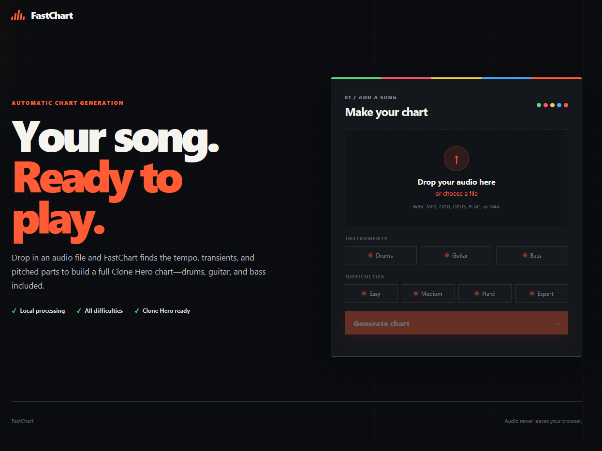
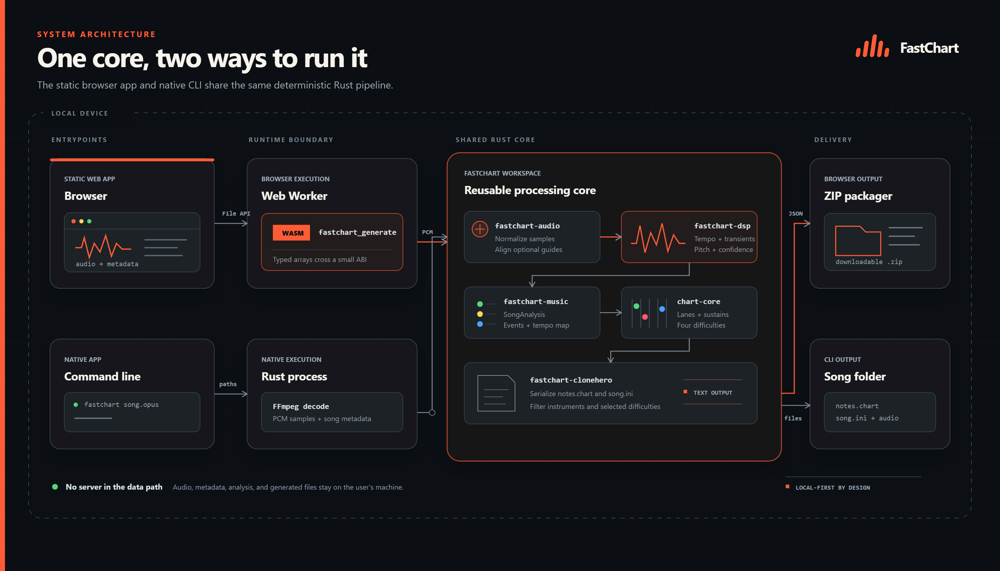

<p align="center">
  
</p>

<p align="center">
  Generate drum, guitar, and bass charts for Clone Hero from any song.<br>
  Free, and it runs in your browser, not a server.
</p>

<p align="center">
  
</p>

## Pipeline

FastChart is split into a small browser shell and a Rust analysis engine. The
browser handles files and audio formats; Rust does the number-heavy work of
finding musical events and turning them into a chart. Everything runs on your
machine, so the song never has to be uploaded to a server.

### 1. Decode the song

The browser opens the selected file with the Web Audio API and turns it into
floating-point PCM samples, a plain stream of numbers representing the waveform.
Formats Clone Hero already understands, such as MP3, OGG, OPUS, and
WAV, are kept for the final download. Other decodable formats are converted to
a standard 16-bit WAV locally.

FastChart averages the channels into a normalized mono signal for the main
analysis. Guitar and bass timing and pitch both come from that complete mix.
This proved more reliable than automatically subtracting the stereo channels,
which can remove real guitar information along with centered vocals. The native
CLI still offers an explicit guide mode for cases where a genuinely separated
accompaniment or guitar stem is available. In that mode the guide answers *when
did an attack happen?*, while pitch still comes from the full mix.

### 2. Listen for musical structure

The prepared samples are handed to a Web Worker, which keeps the page responsive
while the Rust engine runs through WebAssembly. Rust examines the song in short,
overlapping windows using an FFT. Rather than treating the FFT as a mysterious
“AI guess,” FastChart looks for practical cues: sudden changes in frequency
energy, repeating pulses, and stable pitched content.

Those cues become a tempo map and a collection of candidate events. Percussive
events are classified using where their energy sits in the spectrum. Guitar and
bass use instrument-focused frequency bands, onset strength, estimated pitch,
confidence, and duration. The current browser build is conventional DSP, so there
is no model download and no cloud inference.

### 3. Turn detections into something playable

Raw detections are rarely fun as-is. FastChart aligns them to the estimated beat
grid, removes implausibly dense hits, and maps them onto Clone Hero lanes. For
guitar and bass it considers the surrounding pitch contour instead of assigning
each color independently, which helps phrases move naturally across the five
frets. It can also preserve sustains, form chords, and keep repeated riffs
visually consistent.

Expert is the most detailed interpretation. Hard, Medium, and Easy are derived
from it by reducing density and simplifying the available lanes: Easy uses the
first three colors, Medium adds the fourth, and Hard and Expert can use all five.
That means the lower difficulties remain recognizably the same song instead of
being four unrelated charts.

### 4. Build the Clone Hero song

Finally, FastChart writes `notes.chart` and `song.ini`, adds the playable audio
plus any album or background artwork, and packages everything into one ZIP.
Unzip it into the Clone Hero `Songs` directory, scan for songs, and it is ready
to play.

FastChart is aiming for a convincing, playable abstraction rather than a perfect
note-for-note transcription of every instrument in a finished mix. That last
part is genuinely difficult, but the deterministic pipeline makes each decision
fast, inspectable, and easy to improve as the project evolves.

## Architecture

<p align="center">
  
</p>

## Run

FFmpeg must be available on `PATH` for native audio decoding.

```powershell
cargo run -p fastchart -- "path/to/song.opus" fastchart-output "Song Name" "Artist"
```

The ordinary single-file command analyzes drums, guitar, and bass from the same local mix. Separated stems generally produce better instrument classification when available.

Generate a combined drums, guitar, and bass chart from separated stems:

```powershell
cargo run -p fastchart -- stems "backing.opus" "guitar.opus" "bass.opus" "drums.wav" fastchart-output "Song Name" "Artist"
```

Inspect an existing chart:

```powershell
cargo run -p fastchart -- inspect "path/to/notes.chart"
```

Both `.chart` and `notes.mid` files can be inspected. To evaluate generated onset timing and drum-lane agreement against an authored chart:

```powershell
cargo run -p fastchart -- evaluate "path/to/audio.wav" "path/to/notes.mid-or-chart"
```

Compare generated guitar or bass timing with an authored MIDI:

```powershell
cargo run -p fastchart -- compare-pitched "generated/notes.chart" "reference/notes.mid-or-chart" guitar
```

Run the full test suite:

```powershell
cargo test --workspace
```

The reusable audio/DSP/chart crates do not invoke FFmpeg. The browser app decodes with the Web Audio API and passes mono PCM into `fastchart-dsp`, keeping audio entirely local.

## Browser app

The static browser app lives in `apps/web`. It runs analysis in a Web Worker,
calls the Rust engine through WebAssembly, and packages `notes.chart`, `song.ini`,
and Clone Hero-compatible audio into a ready-to-play ZIP without uploading the
song. MP3, OGG, OPUS, and WAV inputs are preserved; other decoded formats such
as FLAC and M4A are converted locally to 16-bit PCM WAV.

```powershell
cd apps/web
npm run build
npm run test:wasm
npm run serve
```

Then open `http://127.0.0.1:4173`. Building requires Rust's
`wasm32-unknown-unknown` target (`rustup target add wasm32-unknown-unknown`).
